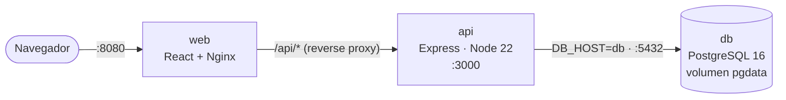
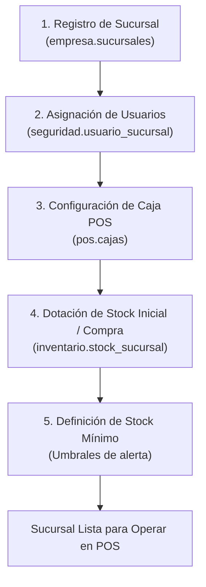
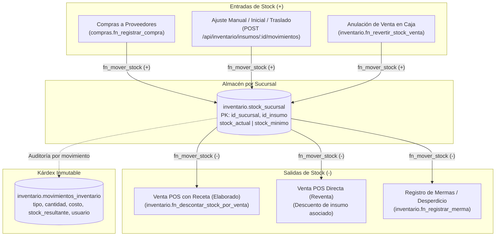
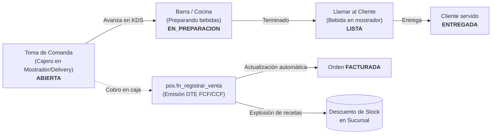
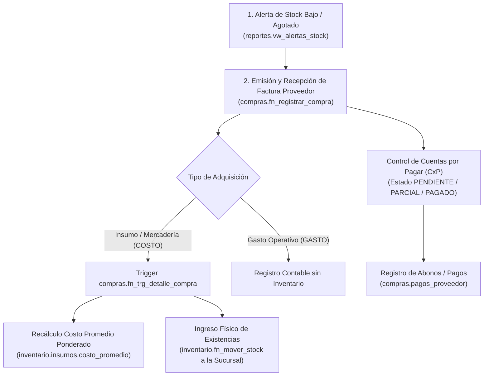
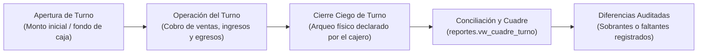

<div align="center">

# artesa

### ERP + POS para la gestión integral de una cafetería y panadería artesanal


*Proyecto de cátedra — Programación Web (ciclo 02-2026)*

</div>

---

## Tabla de contenidos

- [Propósito del proyecto](#propósito-del-proyecto)
- [Funcionalidades principales](#funcionalidades-principales)
- [Arquitectura y estructura del proyecto](#arquitectura-y-estructura-del-proyecto)
  - [Arquitectura general](#arquitectura-general)
  - [Estructura de carpetas](#estructura-de-carpetas)
  - [Stack tecnológico](#stack-tecnológico)
- [Guía rápida de instalación y ejecución](#guía-rápida-de-instalación-y-ejecución)
  - [Requisitos previos](#requisitos-previos)
  - [Opción 1: desarrollo local con pnpm](#opción-1-desarrollo-local-con-pnpm)
  - [Opción 2: entorno completo con Docker Compose](#opción-2-entorno-completo-con-docker-compose)
  - [Resumen de URLs y puertos](#resumen-de-urls-y-puertos)
- [Base de datos: esquema y migraciones](#base-de-datos-esquema-y-migraciones)
- [Pruebas y control de calidad (QA)](#pruebas-y-control-de-calidad-qa)
- [Flujo de uso y casos de ejemplo](#flujo-de-uso-y-casos-de-ejemplo)
- [Flujos de negocio y lógica operativa](#flujos-de-negocio-y-lógica-operativa)
  - [1. Ciclo de vida y apertura de una sucursal](#1-ciclo-de-vida-y-apertura-de-una-sucursal)
  - [2. Flujo integral de inventario y recetas](#2-flujo-integral-de-inventario-y-recetas)
  - [3. Flujo de pedidos del cliente y preparación KDS](#3-flujo-de-pedidos-del-cliente-y-preparación-kds)
  - [4. Flujo de abastecimiento y compras a proveedores](#4-flujo-de-abastecimiento-y-compras-a-proveedores)
  - [5. Flujo de caja, turnos y cuadre](#5-flujo-de-caja-turnos-y-cuadre)
- [Credenciales de prueba](#credenciales-de-prueba)
- [Trabajo con agentes de IA](#trabajo-con-agentes-de-ia)
- [Flujo de trabajo colaborativo (Git Flow)](#flujo-de-trabajo-colaborativo-git-flow)
- [Equipo](#equipo)
- [Preguntas frecuentes y solución de problemas](#preguntas-frecuentes-y-solución-de-problemas)

---

## Propósito del proyecto

Los negocios de alimentos artesanales (cafeterías, panaderías) suelen llevar sus operaciones en cuadernos, hojas de cálculo y herramientas desconectadas: las ventas por un lado, el inventario por otro, y la planilla en un tercer archivo. El resultado son inventarios desactualizados, cierres de caja que no cuadran y decisiones tomadas sin datos.

**artesa** unifica esas operaciones en una sola aplicación web:

- **POS (punto de venta):** registra ventas y cobros en mostrador.
- **ERP (planificación de recursos):** administra inventario, recetas, compras, personal y reportes sobre una única base de datos, de modo que cada venta descuenta existencias automáticamente.

> **¿Qué es un ERP?** Un sistema que integra en un solo lugar los procesos internos de un negocio (ventas, inventario, compras, recursos humanos), evitando la duplicación de datos entre herramientas.

---

## Funcionalidades principales

| Módulo | Qué resuelve |
|--------|--------------|
| **Seguridad y roles** | Inicio de sesión y permisos diferenciados por rol (administrador, gerente, cajero, barista, bodega). |
| **Inventario y recetas** | Control de existencias, kárdex de movimientos y recetas que relacionan productos con insumos. |
| **POS y facturación** | Registro de ventas, cobro y emisión de comprobantes. |
| **Caja y turnos** | Apertura y cierre de turnos de caja y conciliación del efectivo. |
| **Compras y proveedores** | Catálogo de proveedores y registro de compras de insumos. |
| **RR. HH. y planilla** | Gestión de empleados y cálculo de planilla. |
| **Dashboard y reportes** | Indicadores y reportes del negocio para la toma de decisiones. |
| **Empresa y sucursales** | Configuración de establecimientos físicos y parámetros operativos/fiscales globales. |
| **Área cliente** | Acceso separado para clientes en `/cliente/login`. |

---

## Arquitectura y estructura del proyecto

### Arquitectura general

El sistema sigue una arquitectura de tres capas: una interfaz React, una API REST en Express y una base de datos PostgreSQL. En modo Docker, Nginx sirve el frontend y reenvía las peticiones `/api/*` al backend.



### Estructura de carpetas

> Árbol orientativo con los directorios y archivos clave mencionados en el proyecto. Puede contener archivos adicionales.

```text
artesa/
├── backend/                  # API REST (Express, Node 22)
│   ├── Dockerfile            # Imagen del servicio `api`
│   └── .env.example          # Variables de entorno del backend
├── frontend/                 # Interfaz web (React + Vite + Tailwind)
│   └── .env.example          # Variables de entorno del frontend
├── database/
│   ├── init/                 # Scripts que Docker ejecuta en el primer arranque
│   │   ├── 01_schema.sql             # Esquema: tablas, funciones, triggers, vistas
│   │   ├── 02_create_web_user.sql    # Rol restringido `web_user` para la aplicación
│   │   ├── 03_soft_delete.sql        # Columna `deleted_at` (eliminación lógica)
│   │   └── 04_timestamps.sql         # Columna `modificado_en` + triggers automáticos
│   ├── migrations/           # Migraciones para bases de datos ya existentes
│   ├── seeders/              # Datos iniciales aplicables con `pnpm db:seed`
│   └── demo/
│       └── 02_demo.sql       # Datos de ejemplo para demostración
├── test/                     # Batería de pruebas automatizadas (node --test)
├── scripts/
│   └── db.js                 # Runner de migraciones y seeders (registra SHA-256)
├── docs/
│   ├── ai/                   # Contexto para agentes de IA y CHANGELOG_AGENTE.md
│   └── USO_IA.md             # Declaración del uso de IA en el proyecto
├── docker-compose.yml        # Orquestación de los servicios db, api y web
├── AGENTS.md                 # Instrucciones comunes para agentes de IA
├── .env.example              # Variables de entorno raíz (usadas por Docker Compose)
└── README.md                 # Este documento
```

| Elemento | Responsabilidad |
|----------|-----------------|
| `test/` | Pruebas de contrato de API, validaciones Zod, FSM, seguridad y lógica pura. |
| `backend/` | Lógica de negocio, autenticación y acceso a datos mediante una API REST. |
| `frontend/` | Pantallas de administración, POS y área cliente. |
| `database/init/` | Crea el esquema completo en el primer arranque del contenedor. |
| `database/migrations/` | Aplica cambios incrementales sobre bases con datos existentes. |
| `scripts/db.js` | Ejecuta migraciones y seeders pendientes y detecta cambios no autorizados en archivos ya aplicados. |
| `docs/ai/` | Contexto y bitácora de cambios hechos con asistencia de IA. |

### Stack tecnológico

| Capa | Tecnología | Notas |
|------|-----------|-------|
| Frontend | React, Vite, Tailwind CSS | Recarga en caliente en desarrollo. |
| Backend | Express sobre Node.js 22 | Endpoint de salud: `/api/health`. |
| Base de datos | PostgreSQL 16 (Alpine) | Persistencia en el volumen `pgdata`. |
| Gestor de paquetes | pnpm (workspace) | Un solo `pnpm install` para raíz, backend y frontend. |
| Contenedores | Docker Compose | Servicios `db`, `api` y `web`. |
| Servidor web | Nginx | Sirve estáticos y actúa como reverse proxy hacia la API. |
| Pruebas / QA | Node.js Test Runner (`node --test`) | 125 pruebas automatizadas (unitarias, contratos de API y FSM). |

---

## Guía rápida de instalación y ejecución

Hay dos formas de ejecutar el proyecto. Elige según tu objetivo:

| Criterio | Opción 1: `pnpm` + Docker (solo BD) | Opción 2: Docker Compose completo |
|----------|-------------------------------------|-----------------------------------|
| Uso recomendado | Programar y depurar | Evaluar o simular producción |
| Hot Reload | Sí (backend y frontend) | No |
| Requiere Node y pnpm | Sí | No |
| Requiere Docker | Sí (solo la BD) | Sí (todo el sistema) |
| Frontend | `http://localhost:5173` | `http://localhost:8080` |

### Requisitos previos

- [Git](https://git-scm.com/)
- [Docker](https://www.docker.com/) con Docker Compose
- **Solo para la Opción 1:** Node.js 22 y `pnpm`

```bash
# Instalar pnpm si aún no lo tienes
npm install -g pnpm
```

### Opción 1: desarrollo local con pnpm

Ejecuta únicamente la base de datos en Docker; backend y frontend corren en tu máquina con recarga automática.

```bash
# 1. Crear los archivos de variables de entorno
cp .env.example .env
cp frontend/.env.example frontend/.env
cp backend/.env.example backend/.env

# 2. Levantar solo la base de datos PostgreSQL
docker compose up -d db

# 3. Instalar dependencias de todo el workspace (raíz, backend y frontend)
pnpm install

# 4. Iniciar backend y frontend en modo desarrollo
pnpm dev
```

- **Frontend (Vite):** <http://localhost:5173>
- **API (Express):** <http://localhost:3000/api/health>

<details>
<summary><strong>Ejecutar backend o frontend por separado</strong></summary>

```bash
# Solo backend
pnpm --filter artesa-backend dev

# Solo frontend
pnpm --filter artesa-frontend dev
```

</details>

### Opción 2: entorno completo con Docker Compose

Pensada para probar la aplicación tal como correría en producción, sin instalar Node ni pnpm en tu máquina.

<details>
<summary><strong>¿Cómo funciona esta arquitectura? (3 servicios)</strong></summary>

Docker Compose levanta y conecta tres servicios aislados en una misma red virtual interna:

1. **`db` (PostgreSQL 16 Alpine)**
   - Inicializa el esquema (`database/init/01_schema.sql` y siguientes) la primera vez.
   - Persiste los datos en el volumen Docker `pgdata`.
   - Incluye un *healthcheck* (`pg_isready`) para que el backend espere a que la BD esté lista.
2. **`api` (Backend Express)**
   - Se construye con `backend/Dockerfile` sobre una imagen Node 22.
   - Se conecta a la base con `DB_HOST=db` y puerto `5432` (no usa el `localhost` de tu máquina).
   - Expone el puerto `3000`.
3. **`web` (Frontend React + Nginx)**
   - Se compila en una fase *multi-stage* y sirve los archivos estáticos con Nginx.
   - Actúa como **reverse proxy**: redirige `/api/*` al contenedor `api:3000`.
   - Expone la aplicación en el puerto `8080`.

</details>

```bash
# 1. Crear el archivo de entorno raíz
cp .env.example .env
#    Edita .env y reemplaza TODOS los valores CAMBIAR_*

# 2. Construir las imágenes y levantar los contenedores en segundo plano
docker compose up -d --build

# 3. Verificar el estado y revisar los registros
docker compose ps
docker compose logs -f

# 4. Detener los servicios cuando termines
docker compose down
```

> [!WARNING]
> El archivo `.env` contiene secretos. **Nunca lo subas a Git.**

- **Aplicación web:** <http://localhost:8080>
- **API directa:** <http://localhost:3000/api/health>

### Resumen de URLs y puertos

| Servicio | Opción 1 (`pnpm`) | Opción 2 (Docker) |
|----------|-------------------|-------------------|
| Frontend | `http://localhost:5173` | `http://localhost:8080` |
| API (salud) | `http://localhost:3000/api/health` | `http://localhost:3000/api/health` |
| PostgreSQL | `5432` (contenedor `db`) | `5432` (red interna Docker) |

---

## Base de datos: esquema y migraciones

La aplicación usa el rol restringido `WEB_DB_USER` (por defecto `web_user`), definido en `.env`. El rol `POSTGRES_USER` es el administrador que usa Docker.

### Clon fresco (modo recomendado)

Al levantar el contenedor con el volumen vacío, Docker ejecuta **todos** los archivos de `database/init/` en orden alfabético:

| Archivo | Qué hace |
|---------|----------|
| `01_schema.sql` | Esquema completo (tablas, funciones, triggers, vistas). |
| `02_create_web_user.sql` | Rol restringido `web_user` para la aplicación. |
| `03_soft_delete.sql` | Columna `deleted_at` en catálogos (eliminación lógica). |
| `04_timestamps.sql` | Columna `modificado_en` y triggers `BEFORE UPDATE` automáticos. |
| `05_dashboard.sql` | Vistas y métricas agregadas del dashboard de negocio. |
| `05_rbac_roles_activos.sql` | Soporte de borrado lógico e integridad para roles y permisos activos. |
| `06_bitacora_analitica.sql` | Auditoría analítica (`ip_cliente`, `agente_cliente`, `severidad`) e índices. |

```bash
# En un clon limpio basta con esto
docker compose up -d db
```

> [!IMPORTANT]
> Docker solo ejecuta `database/init/` cuando el volumen `pgdata` está **vacío** (primera vez). Si ya tienes datos, aplica las migraciones manualmente.

### ¿Qué método usar?

| Situación | Solución |
|-----------|----------|
| Cloné el repositorio y levanto por primera vez | `docker compose up -d` (automático). |
| Ya tenía datos y llegó una migración nueva | Opción A (`psql`) u Opción B (`pnpm db:migrate`). |
| Quiero un entorno limpio desde cero | `docker compose down -v && docker compose up -d` |

> [!CAUTION]
> `docker compose down -v` **elimina el volumen `pgdata`** y, con él, todos los datos almacenados.

<details>
<summary><strong>Base existente — Opción A: <code>psql</code> directo (más simple)</strong></summary>

```powershell
# Levanta la BD si no está corriendo
docker compose up -d db

# Aplica cada migración pendiente, en orden
docker exec -i artesa-db-1 psql -U $env:POSTGRES_USER -d $env:POSTGRES_DB < database/migrations/003_soft_delete.sql
docker exec -i artesa-db-1 psql -U $env:POSTGRES_USER -d $env:POSTGRES_DB < database/migrations/004_timestamps.sql
```

> Los comandos usan sintaxis de PowerShell (Windows). El nombre `artesa-db-1` puede variar según el nombre de tu carpeta; verifícalo con `docker compose ps`.

</details>

<details>
<summary><strong>Base existente — Opción B: runner <code>scripts/db.js</code> (con registro de migraciones)</strong></summary>

El runner se conecta con `DATABASE_URL` o con las variables `POSTGRES_*` del entorno. Registra cada archivo aplicado en `public.schema_migrations` junto con su hash SHA-256 y **no reaplica** archivos ya registrados. Si un archivo ya aplicado fue modificado, falla para evitar deriva del esquema.

```powershell
docker compose up -d db
pnpm db:migrate   # aplica las migraciones pendientes de database/migrations/
pnpm db:seed      # aplica los seeders pendientes de database/seeders/
```

</details>

---

## Pruebas y control de calidad (QA)

El proyecto cuenta con una suite integral de **125 pruebas automatizadas** que se ejecutan utilizando el runner nativo de Node.js (`node:test`) sin necesidad de levantar servicios externos ni base de datos activa:

```bash
# Ejecutar todas las pruebas del proyecto
pnpm test
```

### Estrategia de pruebas

Las pruebas cubren tanto el backend como el frontend bajo una arquitectura por capas:

1. **Contratos de API y Seguridad (Backend):**
   - **Autenticación y Sesión (`test/auth-contracts.test.js`):** límites de intentos de login (`express-rate-limit`), cookies HTTP-only, validación de estado activo (`activo = true`) y mitigación de enumeración de usuarios.
   - **Empresa y Sucursales (`test/empresa-contracts.test.js`):** RBAC estricto (`EMP_GESTIONAR_SUCURSALES`, `EMP_EDITAR_PARAMETROS`), validaciones Zod, transacciones (`withTransaction`) y manejo de unicidad (409).
   - **Dashboard y Políticas (`test/dashboard-contracts.test.js`):** esquemas de consulta estrictos (`strictObject`), aislamiento por sucursal vs. ventas propias, ocultamiento selectivo de importes en ranking según permisos.
   - **Seguridad y Usuarios (`test/usuarios-contracts.test.js`):** esquemas de alta/edición, hashing seguro con `bcrypt`, transacciones con bitácora y protección anti-bloqueo/auto-eliminación de cuentas activas.
   - **POS y Preparación (`test/pos-ordenes-t02.test.js`, `test/pos-preparacion-contracts.test.js`):** máquina de estados finitos (FSM) estricta, bloqueos por concurrencia (`FOR UPDATE`) y regla anti-float.
   - **Caja e Inventario (`test/caja-contracts.test.js`, `test/inventario-contracts.test.js`):** cuadre de turnos, llamado de funciones SQL críticas y kárdex.

2. **Lógica de Negocio y Utilidades (Frontend):**
   - **Cálculo de Impuestos y POS (`test/frontend-pos-logic.test.js`):** desglose exacto de IVA 13% en precios incluidos y reducer de carrito (límites por stock, agregar, cambiar cantidades, vaciar).
   - **Formatos y Traducción de Errores (`test/frontend-formatos-errores.test.js`):** formateo monetario sin pérdida de precisión sobre tipos NUMERIC, fechas locales sin desfase horario y traducción amigable de errores HTTP y PostgreSQL (P0001, 23505).
   - **RBAC y Navegación Dinámica (`test/frontend-rbac-menu.test.js`):** filtrado recursivo de menús por permisos, validación de códigos de permiso en mayúsculas y agrupación por módulos.
   - **Menú del POS y encabezados (`test/frontend-pos-menu.test.js`):** agrupamiento por categoría sin pérdida de datos, CCF condicionado a `POS_EMITIR_CCF`, menú condicionado a `INV_VER_STOCK` y uso del encabezado compartido.
   - **Contratos de Pantallas (`test/frontend-pages-contracts.test.js`):** consumo a través del cliente unificado (`api/client.js`), protección de rutas con `ProtectedRoute` y transparencia mediante `PendienteApiPage` para módulos sin endpoints backend.

---

## Flujo de uso y casos de ejemplo

Con la aplicación en marcha (consulta [Guía rápida](#guía-rápida-de-instalación-y-ejecución)), sigue estos recorridos para validar las funciones principales. Las credenciales están en [Credenciales de prueba](#credenciales-de-prueba).

### Caso 0: verificar que el sistema está vivo

```bash
curl http://localhost:3000/api/health
```

Si la API y su conexión funcionan, recibirás una respuesta exitosa. Si falla, revisa [Preguntas frecuentes](#preguntas-frecuentes-y-solución-de-problemas).

### Caso 1: ingresar al área administrativa

1. Abre `/admin/login` (por ejemplo, `http://localhost:8080/admin/login`).
2. Inicia sesión con `admin` / `Cambiar123*`.
3. Explora los módulos disponibles para ese rol.

### Caso 2: probar los permisos por rol

1. Cierra sesión e ingresa con otro usuario demo, por ejemplo `cajero1`.
2. Observa que solo ves las opciones correspondientes a su rol.
3. Repite con `bodega1` y compara las diferencias.

### Caso 3: recorrido sugerido de una jornada

| Paso | Usuario | Acción |
|------|---------|--------|
| 1 | `gerente1` | Revisar catálogo, recetas e inventario de ejemplo. |
| 2 | `cajero1` | Abrir turno de caja y registrar una venta en el POS. |
| 3 | `bodega1` | Consultar el inventario y comprobar el movimiento generado por la venta. |
| 4 | `gerente1` | Cerrar el turno y revisar el dashboard y los reportes. |

> Los pasos del Caso 3 describen el recorrido previsto de los módulos; los nombres exactos de pantallas y botones pueden variar según el avance de cada módulo.

### Caso 4: probar el área de clientes

1. Abre `/cliente/login`.
2. Inicia sesión con `cliente.demo` / `Cliente123*`.

---

## Flujos de negocio y lógica operativa

Este apartado describe en detalle cómo interactúan los módulos de **artesa** en el día a día operativo, desde la apertura de sucursales hasta el KDS de baristas, el control de inventario y el cuadre de caja.

> **Menú de navegación rápida:**
> - [1. Ciclo de vida y apertura de una sucursal](#1-ciclo-de-vida-y-apertura-de-una-sucursal)
> - [2. Flujo integral de inventario y recetas](#2-flujo-integral-de-inventario-y-recetas)
> - [3. Flujo de pedidos del cliente y preparación KDS](#3-flujo-de-pedidos-del-cliente-y-preparación-kds)
> - [4. Flujo de abastecimiento y compras a proveedores](#4-flujo-de-abastecimiento-y-compras-a-proveedores)
> - [5. Flujo de caja, turnos y cuadre](#5-flujo-de-caja-turnos-y-cuadre)

---

### 1. Ciclo de vida y apertura de una sucursal

En **artesa**, el catálogo de productos y recetas es corporativo y centralizado; sin embargo, cada establecimiento físico opera de forma aislada e independiente en cuanto a empleados, cajas registradoras y existencia física de inventario.



#### Pasos para la puesta en marcha:
1. **Creación en base de datos (`empresa.sucursales`)**: Se ingresan los datos de establecimiento (código DTE, nombre, dirección y departamento). La sucursal nace sin usuarios ni stock.
2. **Asignación de personal (`seguridad.usuario_sucursal`)**: Los cajeros, gerentes y baristas deben vincularse a la sucursal. Los middlewares de autenticación impiden que un empleado vea o mueva inventario de sedes no autorizadas.
3. **Punto de venta físico (`pos.cajas`)**: Se configura la caja registradora asignada a la sucursal con su código de punto de venta y series fiscales.
4. **Carga de inventario inicial**: Mediante un movimiento de tipo `INVENTARIO_INICIAL` o `TRASLADO_ENTRADA` (o una primera compra), se asignan existencias en `inventario.stock_sucursal`.
5. **Umbrales preventivos**: Se establece el `stock_minimo` por insumo para disparar alertas automáticas de reabastecimiento en el dashboard.

[↑ Volver al menú de flujos](#flujos-de-negocio-y-lógica-operativa)

---

### 2. Flujo integral de inventario y recetas

El inventario físico vive exclusivamente en la tabla `inventario.stock_sucursal` indexada por `(id_sucursal, id_insumo)`. Todas las alteraciones pasan obligatoriamente por la función con bloqueo transaccional `inventario.fn_mover_stock`.



#### Reglas de negocio y mínimo para operar:
* **Catálogo central vs. existencias locales**: Las recetas no se duplican por sucursal. La sucursal comparte el recetario global, pero su disponibilidad real depende de su propio stock en bodega.
* **Cálculo de unidades preparables**: En el punto de venta, la cantidad máxima que se puede preparar de un producto elaborado se calcula dinámicamente según el insumo más escaso de la receta:
  $$\text{Unidades Preparables} = \min_{i \in \text{Receta}} \left( \left\lfloor \frac{\text{Stock Disponible}_i}{\text{Cantidad Requerida}_i} \right\rfloor \right)$$
* **Protección contra stock negativo**: Con el parámetro `permitir_stock_negativo = 'false'`, cualquier venta o salida que deje el saldo menor a cero arroja una excepción SQL `P0001 (Stock insuficiente)` y aborta la transacción.
* **Semáforo de alertas preventivas (`reportes.vw_alertas_stock`)**:
  * `AGOTADO` (`stock_actual <= 0`): Alerta crítica; venta bloqueada en POS.
  * `BAJO_MINIMO` (`stock_actual <= stock_minimo`): Advertencia preventiva para reabastecimiento antes de agotar existencias.

[↑ Volver al menú de flujos](#flujos-de-negocio-y-lógica-operativa)

---

### 3. Flujo de pedidos del cliente y preparación KDS

Gestiona el ciclo de vida de las comandas desde que el cliente ordena en mostrador hasta la preparación en barra y su cobro fiscal.



#### Estados de una comanda (`pos.ordenes`):
| Estado | Responsable | Acción en cafetería |
|---|---|---|
| `ABIERTA` | Cajero | Toma de productos, variantes y notas especiales (ej. "sin azúcar", "leche deslactosada"). |
| `EN_PREPARACION` | Barista | Inicio de preparación en barra visualizada en la pantalla KDS (`/api/pos/preparacion`). |
| `LISTA` | Barista | Notificación o llamado al cliente para retirar su bebida en el mostrador de entrega. |
| `ENTREGADA` | Servicio / Barra | El cliente retira sus productos físicamente. |
| `FACTURADA` | Sistema POS | Registro del pago, emisión del documento tributario electrónico (DTE) y descuento automático de insumos en inventario. |
| `ANULADA` | Cajero | Cancelación previa al inicio de preparación en barra. |

[↑ Volver al menú de flujos](#flujos-de-negocio-y-lógica-operativa)

---

### 4. Flujo de abastecimiento y compras a proveedores

Describe cómo ingresa la mercadería a las bodegas de la empresa y cómo se gestionan las cuentas por pagar asociadas.



#### Aspectos destacados:
* **Recálculo de costo promedio**: Cada compra actualiza el costo unitario de los insumos ponderando las existencias previas con las nuevas:
  $$\text{Costo Nuevo} = \frac{(\text{Stock Previo} \times \text{Costo Previo}) + (\text{Cantidad Nueva} \times \text{Costo Nuevo})}{\text{Stock Previo} + \text{Cantidad Nueva}}$$
* **Compras tipo Gasto vs. Costo**: Las facturas de energía eléctrica, internet o alquiler se registran como `GASTO` sin afectar existencias ni recetas.
* **Automatización de CxP**: El trigger `compras.fn_trg_pago_proveedor` actualiza de forma automática el saldo pendiente de las compras al crédito.

[↑ Volver al menú de flujos](#flujos-de-negocio-y-lógica-operativa)

---

### 5. Flujo de caja, turnos y cuadre

Garantiza la conciliación estricta del efectivo y los pagos electrónicos en cada punto de venta físico.



#### Reglas de control de caja:
* **Unicidad de turno**: Una caja solo puede tener un turno abierto a la vez por un cajero específico.
* **Cierre ciego**: El cajero declara el efectivo real en gaveta y los comprobantes físicos de tarjeta sin conocer el saldo teórico calculado por el sistema, previniendo manipulaciones.
* **Auditoría de diferencias**: El sistema calcula la diferencia (`dif_efectivo`, `dif_tarjeta`) y queda asentada en la bitácora para revisión del gerente o auditor.

[↑ Volver al menú de flujos](#flujos-de-negocio-y-lógica-operativa)

---

## Credenciales de prueba

> [!NOTE]
> Estas credenciales son solo para demostración. Los datos de ejemplo se encuentran en `database/demo/02_demo.sql`. **No las uses en producción.**

| Área | Usuario | Contraseña | Ruta de acceso |
|------|---------|-----------|----------------|
| Administrativa | `admin` | `Cambiar123*` | `/admin/login` |
| Administrativa | `gerente1` | `Cambiar123*` | `/admin/login` |
| Administrativa | `cajero1` | `Cambiar123*` | `/admin/login` |
| Administrativa | `barista1` | `Cambiar123*` | `/admin/login` |
| Administrativa | `bodega1` | `Cambiar123*` | `/admin/login` |
| Cliente | `cliente.demo` | `Cliente123*` | `/cliente/login` |

---

## Trabajo con agentes de IA

El proyecto admite asistentes como **opencode**, **Cursor** y **Antigravity**.

- Todos leen el archivo `AGENTS.md` (`GEMINI.md` y `.cursor/rules` solo apuntan a él).
- El contexto adicional está en `docs/ai/`.
- Cada cambio realizado con IA se registra en `docs/ai/CHANGELOG_AGENTE.md`.
- El uso de IA se declara en `docs/USO_IA.md`.

---

## Flujo de trabajo colaborativo (Git Flow)

Se usa una adaptación práctica de **Git Flow**:

| Rama | Propósito | Reglas |
|------|-----------|--------|
| `main` | Versiones estables, listas para entrega o defensa. | Protegida; no se hacen commits directos. |
| `develop` | Integración diaria. | Recibe el trabajo completado y probado. |
| `feature/<modulo>-<descripcion>` | Una funcionalidad individual. | Ej.: `feature/pos-cobro`, `feature/inventario-kardex`. |

### Crear una rama de trabajo

```bash
git checkout develop
git pull origin develop
git checkout -b feature/<modulo>-<descripcion>
```

### Convención de commits

El proyecto sigue una convención estricta que combina **Gitmoji** y **Conventional Commits** en formato `<emoji> <tipo>(<alcance>): <descripción>`:

| Gitmoji + Prefijo | Uso | Ejemplo |
|---------|-----|---------|
| `:sparkles: feat(<modulo>)` | Nueva funcionalidad | `:sparkles: feat(pos): agregar cobro en efectivo` |
| `:bug: fix(<modulo>)` | Corrección de errores | `:bug: fix(caja): corregir cierre de turno` |
| `:white_check_mark: test(<modulo>)` | Pruebas unitarias o de contrato | `:white_check_mark: test(empresa): validar RBAC de sucursales` |
| `:memo: docs(<modulo>)` | Documentación | `:memo: docs(instalacion): actualizar guía de ejecución` |
| `:recycle: refactor(<modulo>)` | Reestructuración sin cambio funcional | `:recycle: refactor(inventario): simplificar servicio de movimientos` |
| `:wrench: chore(<modulo>)` | Tareas de mantenimiento y dependencias | `:wrench: chore(deps): actualizar paquetes del workspace` |

### Integrar los cambios

Al terminar tu funcionalidad, sube la rama y abre un **Pull Request (PR)** hacia `develop`:

```bash
git push -u origin feature/<modulo>-<descripcion>
```

---

## Equipo

| Módulo | Responsables | Rama |
|--------|--------------|------|
| Empresa y configuración | | `feature/empresa-*` |
| Seguridad y roles | | `feature/seguridad-*` |
| Inventario y recetas | | `feature/inventario-*` |
| POS y facturación | | `feature/pos-*` |
| Caja y turnos | | `feature/caja-*` |
| Compras y proveedores | | `feature/compras-*` |
| RR. HH. y planilla | | `feature/rrhh-*` |
| Dashboard y reportes | | `feature/reportes-*` |
| Documentación, IEEE, despliegue | | `feature/docs-*` |

---

## Preguntas frecuentes y solución de problemas

<details>
<summary><strong>Cambié los scripts de <code>database/init/</code> pero la base no se actualiza</strong></summary>

Docker solo ejecuta esos scripts cuando el volumen `pgdata` está vacío. Para recrear la base desde cero (se pierden los datos):

```bash
docker compose down -v && docker compose up -d
```

Para conservar los datos, usa las migraciones (ver [Base de datos](#base-de-datos-esquema-y-migraciones)).

</details>

<details>
<summary><strong><code>docker exec</code> falla con "No such container: artesa-db-1"</strong></summary>

El nombre del contenedor depende del nombre de la carpeta del proyecto. Consúltalo con:

```bash
docker compose ps
```

Luego sustituye `artesa-db-1` por el nombre que aparezca. También puedes usar la Opción B (`pnpm db:migrate`), que no depende de ese nombre.

</details>

<details>
<summary><strong>El backend no conecta con la base de datos</strong></summary>

- **Opción 1 (`pnpm`):** confirma que la BD está activa con `docker compose ps` y que `backend/.env` apunta a `localhost`.
- **Opción 2 (Docker):** la API debe usar `DB_HOST=db`, no `localhost`; dentro de un contenedor, `localhost` es el propio contenedor.
- Revisa los registros con `docker compose logs -f db api`.

</details>

<details>
<summary><strong>Los puertos 3000, 5173, 5432 u 8080 ya están ocupados</strong></summary>

Otro programa está usando el puerto. Detén ese proceso o cambia el puerto en tu configuración. Para ver qué contenedores tuyos ocupan puertos, ejecuta `docker compose ps`.

</details>

<details>
<summary><strong><code>pnpm: command not found</code></strong></summary>

Instálalo con `npm install -g pnpm` y abre una nueva terminal.

</details>

<details>
<summary><strong>El runner <code>pnpm db:migrate</code> falla indicando que un archivo cambió</strong></summary>

El runner compara el hash SHA-256 de cada migración ya aplicada. Si editaste un archivo que ya estaba registrado, falla a propósito para evitar inconsistencias. No modifiques migraciones aplicadas: crea una **nueva** migración con el cambio.

</details>

<details>
<summary><strong>¿Puedo usar las credenciales demo en producción?</strong></summary>

No. Son datos de demostración con contraseñas conocidas. Para un despliegue real, reemplaza todos los valores `CAMBIAR_*` de `.env` y elimina o cambia los usuarios demo.

</details>

---

<div align="center">

**artesa** · Programación Web · Ciclo 02-2026

</div>