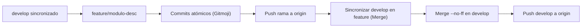

# Skill: Flujo de Rama Feature y Merge a Develop

Esta skill define el procedimiento estricto para crear una rama de características (`feature`), comitear los cambios del trabajo en curso, publicarla en el repositorio remoto (`origin`) y realizar la integración correspondiente en `develop` preservando la autoría y trazabilidad histórica del equipo.

---

## 🚫 Regla de Oro: Prohibición Absoluta de Rebase y Squash

> [!CAUTION]
> **ESTÁ ESTRICTAMENTE PROHIBIDO EL REBASE Y EL SQUASH MERGE EN ARTESA.**
> - ❌ `git rebase` / `git rebase develop` / `git rebase origin/develop`
> - ❌ `git pull --rebase`
> - ❌ `git merge --squash`
>
> **Justificación de cátedra**: En un equipo de 8 personas, cada integrante debe defender individualmente sus aportes ante el docente. El `rebase` reescribe fechas y hashes SHA-1, y el `squash` comprime múltiples aportes en un solo autor, destruyendo la evidencia de autoría y contribución.
>
> **La integración en `develop` SIEMPRE se realiza con `git merge --no-ff`**, generando un commit de unión explícito que mantiene intacto el árbol y los commits del autor.

---

## Ciclo de Vida en 5 Fases



---

### Fase 1: Creación de la Rama Feature desde Develop

1. **Asegurar árbol limpio**:
   ```bash
   git status
   ```
2. **Posicionarse en `develop` y sincronizarlo**:
   Usa la skill `sincronizar-develop` para garantizar que la rama base tiene lo último:
   ```bash
   git checkout develop
   git fetch origin develop
   # Si develop remoto avanzó, actualizar con avance rápido o merge limpio
   git merge --ff-only origin/develop
   ```
3. **Definir el nombre de la rama**:
   Formato obligatorio: `feature/<modulo>-<desc>`
   - `<modulo>`: Nombre del módulo del ERP/POS (`pos`, `caja`, `inventario`, `compras`, `rrhh`, `auth`, `seguridad`, `reportes`, `empresa`, `ui`, `infra`).
   - `<desc>`: Breve descripción en minúsculas separada por guiones (kebab-case).
   - *Ejemplos*: `feature/pos-ticket-pago`, `feature/inventario-filtro-stock`, `feature/compras-cxp-historial`.
4. **Crear y cambiar a la rama**:
   ```bash
   git checkout -b feature/<modulo>-<desc>
   ```

---

### Fase 2: Trabajo y Commits con Convención Estricta

1. Implementa los cambios en el código respetando la arquitectura por capas:
   - Rutas → Controlador HTTP → Servicio de Negocio → Repositorio SQL.
   - Las funciones críticas de negocio se llaman en SQL (`pos.fn_*`, etc.), no se reimplementan en JS.
   - Modificaciones de BD: nueva migración `database/migrations/NNN_*.sql` (nunca editar `01_schema.sql`).
2. **Validación previa**:
   Antes de comitear, corre las pruebas y linter del módulo:
   ```bash
   pnpm test
   pnpm --filter artesa-frontend lint
   ```
3. **Confirmar cambios (Commits)**:
   Aplica de manera estricta la skill `convencion-commits`:
   ```bash
   git add <archivos_modificados>
   git commit -m "<emoji> <tipo>(<alcance>): <descripción>"
   ```
   *Ejemplo*:
   ```bash
   git commit -m "✨ feat(pos): habilitar cobro mixto con ticket térmico de 80mm"
   ```

---

### Fase 3: Publicación de la Rama en Remoto (Push)

Publica tu rama de trabajo en GitHub para respaldo del equipo y revisión:
```bash
git push -u origin feature/<modulo>-<desc>
```

---

### Fase 4: Sincronización Pre-Merge (Descartar conflictos con Develop)

Antes de fusionar tu rama en `develop`, debes asegurar que tu rama incorpore cualquier novedad que tus compañeros hayan subido a `develop` mientras trabajabas:

1. Ejecuta el protocolo de la skill `sincronizar-develop` estando parado en tu rama feature:
   ```bash
   git fetch origin develop
   git rev-list HEAD..origin/develop --count
   ```
2. **Si el conteo es mayor a 0**:
   Integra los cambios de develop en tu feature branch **sin rebase**:
   ```bash
   git merge origin/develop --no-rebase -m "🔀 merge(git): sincronizar develop en feature/<modulo>-<desc> antes de merge"
   ```
   - Si surgen conflictos, resuélvelos unificando las mejoras de ambos lados.
   - Vuelve a ejecutar `pnpm test` para garantizar que la unión de código sigue funcionando al 100%.
   - Sube la actualización de la rama feature:
     ```bash
     git push origin feature/<modulo>-<desc>
     ```
3. **Si el conteo es 0**: No hubo cambios intermedios en develop; continúa a la Fase 5.

---

### Fase 5: Merge hacia la Rama `develop` y Publicación

1. **Cambiar a la rama de integración**:
   ```bash
   git checkout develop
   ```
2. **Asegurar develop local al día**:
   ```bash
   git fetch origin develop
   git merge --ff-only origin/develop
   ```
3. **Ejecutar el merge formal sin fast-forward (`--no-ff`)**:
   > [!IMPORTANT]
   > El flag `--no-ff` es fundamental: crea explícitamente un merge commit que documenta la integración de la rama en el grafo de Git sin aplanar ni alterar la historia individual.
   ```bash
   git merge --no-ff feature/<modulo>-<desc> -m "🔀 merge(<modulo>): integrar rama feature/<modulo>-<desc> en develop"
   ```
4. **Verificación de calidad post-merge**:
   ```bash
   pnpm test
   ```
5. **Subir los cambios integrados a `develop` remoto**:
   ```bash
   git push origin develop
   ```

---

### Fase 6: Cierre y Registro

1. **Registrar el trabajo completado**:
   - Añade 1 línea a `docs/ai/CHANGELOG_AGENTE.md` siguiendo `00-registrar-cambio`:
     ```text
     AAAA-MM-DD | <persona>/<agente> | <modulo> | <resumen del cambio> | <archivos principales>
     ```
   - Si cambió el estado o decisiones de negocio, actualiza `docs/ai/CONTEXT.md` (manteniéndolo en ≤ 60 líneas).
2. **Gestión de la rama feature local**:
   Una vez que el merge fue verificado en `origin/develop`, puedes eliminar la rama local para mantener limpio el entorno:
   ```bash
   git branch -d feature/<modulo>-<desc>
   ```

---

## Checklist de Cierre
- [ ] Rama feature nombrada con patrón `feature/<modulo>-<desc>`.
- [ ] Rama originada desde `develop` actualizado.
- [ ] Commits estructurados según `convencion-commits` (`<emoji> <tipo>(<alcance>): <descripción>`).
- [ ] Rama feature subida a remoto con `git push -u origin feature/<modulo>-<desc>`.
- [ ] Sincronizada con develop previo a la integración final (mergeando origin/develop si hubo cambios).
- [ ] **Ningún uso de `git rebase` ni `git merge --squash`**.
- [ ] Merge a develop ejecutado con `git merge --no-ff`.
- [ ] Suite `pnpm test` en verde antes y después del merge.
- [ ] `develop` actualizado subido con `git push origin develop`.
- [ ] Registro completado en `docs/ai/CHANGELOG_AGENTE.md`.
