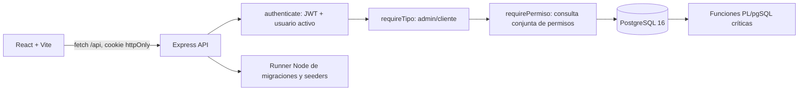
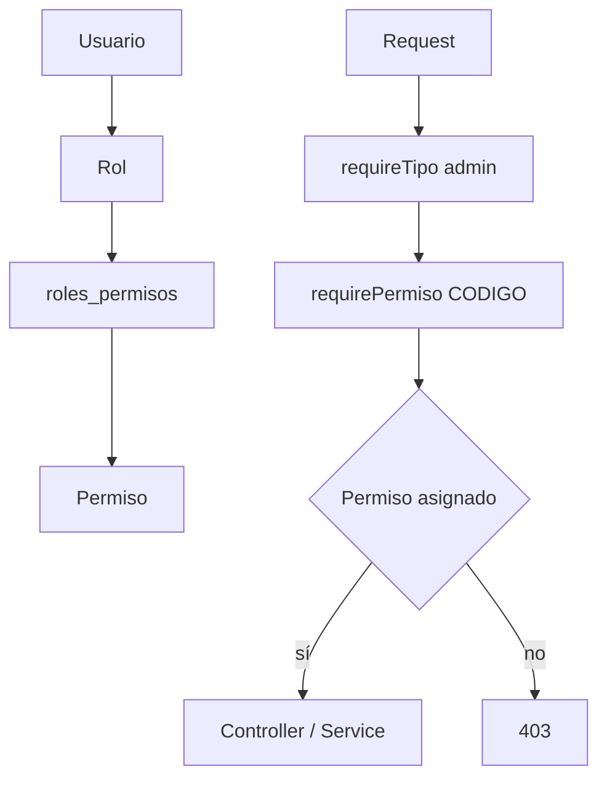

# Arquitectura de artesa



## Autenticación

```mermaid
sequenceDiagram
  participant U as Navegador
  participant A as API
  participant D as PostgreSQL
  U->>A: POST /api/auth/login
  A->>D: Busca usuario activo y compara bcrypt
  A-->>U: Set-Cookie artesa_session (httpOnly, SameSite)
  U->>A: Request con cookie
  A->>A: Verifica JWT (jti, iat, expiración)
  A->>D: Revalida activo=true en cada request
  A-->>U: 401 si fue desactivado; continúa si está activo
```

## Roles y permisos


